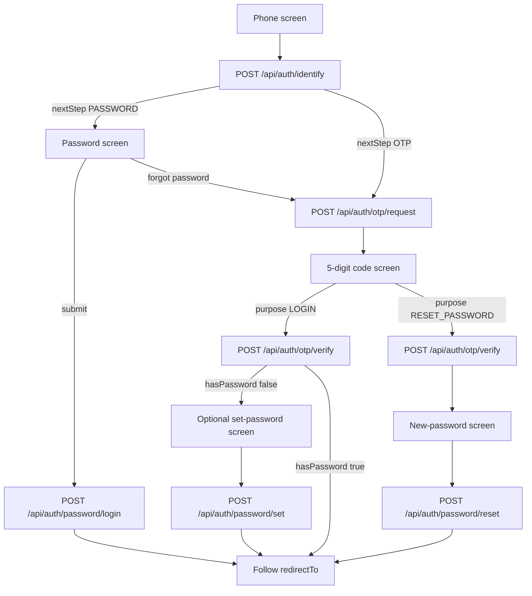

# Frontend login integration

Use this guide to build the phone login screens against this API. Interactive reference: `GET /docs`. Raw contract: `GET /openapi.json`.

There is no signup endpoint. The first successful OTP for a phone creates the account and signs the user in.

There is no logout endpoint and no “current user” endpoint. After login the browser holds an `HttpOnly` session cookie. Treat `GET /api/wallets` returning `401` as signed out. Wallet calls are documented in [frontend-wallet.md](./frontend-wallet.md).

## Transport

Send every auth call to the API origin.

```ts
const API = "http://localhost:3000";

async function authPost(path: string, body: unknown): Promise<Response> {
  return fetch(`${API}${path}`, {
    method: "POST",
    credentials: "include",
    headers: { "Content-Type": "application/json" },
    body: JSON.stringify(body),
  });
}
```

Rules:

- `credentials: "include"` is required. The session is a cookie, not a token in the JSON body.
- Body must be one JSON object. Anything else, including an array, is `400 INVALID_BODY`.
- The browser must call the API on the **same host** as the page. Every POST checks that the `Origin` host equals the request `Host`. A page on `localhost:5173` calling `localhost:3000` gets `403 FORBIDDEN_ORIGIN`. Do not set `Origin` yourself; the browser sets it. In local development, proxy `/api` through the frontend dev server so the page and the API share one host.
- Do not read or store the `session` cookie. It is `HttpOnly`, `SameSite=Lax`, `Path=/`. In production it is also `Secure`.
- A successful login also sets a readable `csrf-token` cookie (`SameSite=Strict`, not `HttpOnly`). Leave it untouched on these screens. Wallet POSTs need it; see the wallet guide.
- Auth POSTs do **not** require `x-csrf-token`.

## Screen flow



`identify` does not reveal whether an account exists. A missing account and an account with no password both return `OTP`. Only an account that already has a password returns `PASSWORD`.

Keep `phoneNumber` in screen state. Later calls send it again; the server does not remember the identify step.

## Fields

### Phone

Accept `09` plus 9 more digits. The server trims the string and converts Persian (`۰-۹`) and Arabic (`٠-٩`) digits to Latin before checking. Send the raw input; you do not have to normalize it.

`09123456789` is valid. `+989123456789`, `9123456789`, and spaces are invalid on `identify` and `otp/request` (`400 INVALID_PHONE`).

On `password/login` and `otp/verify`, a bad phone is `400 INVALID_BODY` (same code as a bad body), so validate the phone on the client before those calls.

### OTP code

Exactly 5 digits. Persian and Arabic digits are accepted. The user has **3** attempts per code (default). Each mismatch returns `attemptsRemaining`. After the last failure the code is burned.

### Password

8 to 128 characters. No other complexity rules. These values are rejected as too common (`400 COMMON_PASSWORD`), case-insensitive:

`password`, `password1`, `12345678`, `123456789`, `1234567890`, `qwertyui`, `qwerty123`, `11111111`, `00000000`, `abcdefgh`, `letmein1`, `iloveyou`, `admin123`, `12341234`.

### `next`

Optional on password login and OTP verify. It must be one relative path with a single leading slash, such as `/wallet`. The server rejects `//host`, schemes, and backslashes and falls back to `"/"`. Put the result’s `redirectTo` into the router. Do not navigate to a URL the user typed.

## Endpoints

### 1. Choose the next screen

`POST /api/auth/identify`

```json
{ "phoneNumber": "09123456789" }
```

`200`

```json
{ "nextStep": "PASSWORD" }
```

`nextStep` is `"PASSWORD"` or `"OTP"`. When it is `"OTP"`, go to the code screen and call `otp/request` immediately.

### 2. Password login

`POST /api/auth/password/login`

```json
{
  "phoneNumber": "09123456789",
  "password": "correct horse",
  "next": "/wallet"
}
```

`next` may be omitted.

`200`

```json
{ "redirectTo": "/wallet" }
```

`Set-Cookie` includes `session` and `csrf-token`. Unknown phone, wrong password, and an account with no password all return the same `401 INVALID_CREDENTIALS`. Do not tell the user which case it was. Offer “send a code” as the recovery path.

Five failures for one phone inside 15 minutes return `429 LOCKED`. Twenty login attempts from one IP inside 15 minutes return `429 RATE_LIMITED`.

### 3. Request a code

`POST /api/auth/otp/request`

```json
{ "phoneNumber": "09123456789" }
```

`200`

```json
{ "cooldownSeconds": 120 }
```

Start a resend timer from `cooldownSeconds`. A resend before it elapses is `429 OTP_COOLDOWN` with `retryAfter` set to the remaining seconds.

In development only (`NODE_ENV` is not `production` and `SMS_DEV_LOG=true`), the body may also contain `devCode` (5 digits). Show it in a dev-only banner. Production never returns it. The real code arrives by SMS and lives **180 seconds**.

Limits, all defaults: 5 SMS per phone per hour, 10 per phone per day, 20 per IP per hour. Crossing any of them is `429 RATE_LIMITED`. SMS vendor failure is `503 SMS_FAILED`; the code was not stored, so the user can retry.

### 4. Verify the code

`POST /api/auth/otp/verify`

Login:

```json
{
  "phoneNumber": "09123456789",
  "code": "12345",
  "purpose": "LOGIN",
  "next": "/wallet"
}
```

`purpose` may be omitted; omitted means `LOGIN`. Any other value than `LOGIN` or `RESET_PASSWORD` is `400 INVALID_BODY`.

`200`

```json
{ "hasPassword": false, "redirectTo": "/wallet" }
```

This response sets the session cookie. The user is signed in even when `hasPassword` is `false`.

- `hasPassword: false` — show an optional “set a password” screen, then follow `redirectTo`. Skipping is valid.
- `hasPassword: true` — follow `redirectTo`.

Forgot-password verify uses the same endpoint with `"purpose": "RESET_PASSWORD"`. The session is created **and** this session is allowed to replace the password once, for **10 minutes**. Take the user to the new-password screen immediately. Do not follow `redirectTo` until `password/reset` succeeds.

Wrong code: `401 OTP_MISMATCH` plus `attemptsRemaining` (integer). Last wrong try: `401 OTP_EXHAUSTED`. After that, or after 180 seconds: `401 OTP_EXPIRED`. Both mean “request a new code”.

### 5. Set a password once

`POST /api/auth/password/set`

Requires the session cookie from step 4. No CSRF header.

```json
{ "password": "correct horse" }
```

`200`

```json
{ "ok": true }
```

Only for an account that has no password. If one already exists: `409 PASSWORD_EXISTS`. Send the user onward; do not loop.

### 6. Replace the password

`POST /api/auth/password/reset`

Requires the session from a `RESET_PASSWORD` verify. No CSRF header.

```json
{ "password": "correct horse" }
```

`200`

```json
{ "ok": true }
```

The current session stays. Every other session for this user is deleted. The reset permission is single-use. Calling reset without that permission, or calling it twice, is `403 RESET_NOT_ALLOWED`. Send the user back through OTP with `purpose: "RESET_PASSWORD"`.

## Errors

Auth failures use one shape. Display `error.message` (Persian). Branch UI on `error.code`.

```json
{
  "error": {
    "code": "OTP_MISMATCH",
    "message": "کد نادرست است.",
    "attemptsRemaining": 2,
    "retryAfter": 90
  }
}
```

`attemptsRemaining` and `retryAfter` are present only when they apply. When `retryAfter` is present, the `Retry-After` header is the same number of seconds. Disable the submit button until that timer ends.

| Status | Code | What the screen should do |
| --- | --- | --- |
| 400 | `INVALID_PHONE` | Keep the user on the phone field. |
| 400 | `INVALID_BODY` | Fix the form. On verify, the code is not 5 digits or the phone is unusable. |
| 400 | `INVALID_PASSWORD` | Password length is outside 8–128. |
| 400 | `COMMON_PASSWORD` | Ask for a different password. |
| 401 | `INVALID_CREDENTIALS` | Generic “phone or password is wrong”. Offer OTP. |
| 401 | `OTP_MISMATCH` | Show `attemptsRemaining`. Keep the same code field. |
| 401 | `OTP_EXHAUSTED` | Clear the code and require a new SMS. |
| 401 | `OTP_EXPIRED` | Same as exhausted. |
| 401 | `UNAUTHORIZED` | Session missing on set/reset. Restart login. |
| 403 | `FORBIDDEN_ORIGIN` | Page and API are on different hosts. Fix the proxy; do not retry in a loop. |
| 403 | `RESET_NOT_ALLOWED` | Restart the forgot-password OTP. |
| 409 | `PASSWORD_EXISTS` | Leave the set-password screen. |
| 429 | `OTP_COOLDOWN` | Keep the resend button disabled for `retryAfter` seconds. |
| 429 | `RATE_LIMITED` | Back off for `retryAfter` seconds. |
| 429 | `LOCKED` | Password form is locked for `retryAfter` seconds. OTP is still a valid path unless that path is limited too. |
| 503 | `SMS_FAILED` | Let the user request the code again. |

`identify` limits default to 10 calls per phone and 30 per IP inside 10 minutes.

## Session lifetime

Defaults: the cookie `Max-Age` is 90 days. The server session slides on use for 30 days and dies 90 days after creation even if the cookie is still present. A dead session surfaces as `401` on the next protected call (`password/set`, `password/reset`, or any wallet route). Send the user to the phone screen.

Each successful password login or OTP verify creates a **new** session id. Older sessions stay valid until reset, expiry, or the absolute cap. Only `password/reset` drops the other devices.
