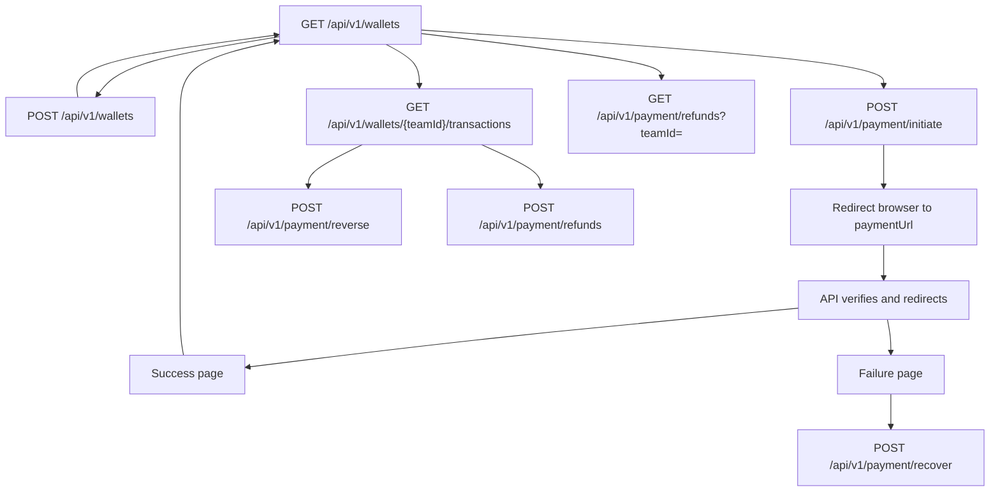

# Frontend wallet integration

Use this guide to build wallet list, top-up, history, gateway reverse, and card-refund screens. Login and the session cookie are documented in [frontend-login.md](./frontend-login.md).

Money is stored in a ledger. Balances are **integers in rials** (not tomans). `availableBalance` is what the user can spend. `restrictedBalance` is included in the payload and is not changed by these flows; display it only if the product needs it. There is no separate balance field to cache: after every successful money call, reload `GET /api/v1/wallets`.

A wallet is a team. `teamId` is the wallet id. The signed-in user must be an active `owner` to charge, read history, reverse, or refund. `GET /api/v1/wallets` also returns other active roles. Hide charge, history, reverse, and refund unless `role` is `"owner"`.

## Transport

```ts
const API = "http://localhost:3000";

function csrfToken(): string {
  const row = document.cookie
    .split("; ")
    .find((part) => part.startsWith("csrf-token="));
  return row ? decodeURIComponent(row.slice("csrf-token=".length)) : "";
}

export async function walletGet(path: string): Promise<Response> {
  return fetch(`${API}${path}`, { credentials: "include" });
}

export async function walletPost(path: string, body: unknown): Promise<Response> {
  return fetch(`${API}${path}`, {
    method: "POST",
    credentials: "include",
    headers: {
      "Content-Type": "application/json",
      "x-csrf-token": csrfToken(),
    },
    body: JSON.stringify(body),
  });
}
```

Rules:

- `credentials: "include"` sends the `session` cookie. The server ignores any user id in the body.
- The page and the API must share one host. Browsers set `Origin`; every wallet POST rejects a different host with `403 FORBIDDEN_ORIGIN`. Proxy `/api` in local development. Do not set `Origin` from JavaScript.
- Every wallet **POST** must send header `x-csrf-token` equal to the `csrf-token` cookie. The cookie is not `HttpOnly`. Login sets it. Authenticated wallet responses set it again when it is missing.
- GETs do not need the CSRF header.
- POST body must be one JSON object.
- You may send `x-request-id`. The server echoes it, truncated to 128 characters. Otherwise it generates one. Payment errors always include `error.traceId`, and the response header `x-request-id` is the same value. Show it on failure screens so support can find the attempt.

`csrf-token` is `SameSite=Strict`. After the browser returns from the bank, that cookie is often absent. Call `GET /api/v1/wallets` once before the next POST; the response stores a fresh `csrf-token`, then read it for `x-csrf-token`.

## Payment return pages

Top-up does not finish on your POST. You send the browser to Zarinpal. Zarinpal sends it back to this API, which verifies the payment and redirects the browser with **307** to URLs configured on the server:

- Success default: `PAYMENT_SUCCESS_REDIRECT_URL` or `http://localhost:3000/docs?payment=ok`
- Failure default: `PAYMENT_FAILURE_REDIRECT_URL` or `http://localhost:3000/docs?payment=failed`

Point those env vars at your frontend routes before shipping, for example:

- `https://app.example.com/wallet/payment/success`
- `https://app.example.com/wallet/payment/failure`

Those pages must live on a host the browser will open. Query string:

| Page | Query | Meaning |
| --- | --- | --- |
| Success | `attemptId` | Gateway attempt that was credited. |
| Success | `traceId` | Support id. |
| Failure | `code` | Machine code. The Persian message is **not** on the URL. |
| Failure | `traceId` | Support id. |

Build the failure copy from `code`:

| `code` | User-facing meaning |
| --- | --- |
| `PAYMENT_NOT_VERIFIED` | The bank did not confirm the payment, or the buyer cancelled. |
| `AMOUNT_MISMATCH` | The confirmed amount did not match the charge. Nothing was credited. |
| `ATTEMPT_NOT_FOUND` | This return does not match a charge. |
| `INVALID_CALLBACK_SIGNATURE` | The return link is not authentic. |
| `GATEWAY_UNAVAILABLE` | The bank could not be reached. Offer recover. |
| `RATE_LIMITED` | Too many returns from this network. Ask the user to open the wallet again. |

On the success page, reload wallets. The new credit is a ledger row of type `GatewayCredit` whose `gatewayAttemptId` equals `attemptId`. If the balance is still unchanged and the code was `GATEWAY_UNAVAILABLE`, call recover.

## Screen flow



## Endpoints

### List wallets

`GET /api/v1/wallets`

`200`

```json
{
  "wallets": [
    {
      "teamId": 4,
      "displayName": "Travel",
      "role": "owner",
      "availableBalance": 5000,
      "restrictedBalance": 0
    }
  ]
}
```

Ordered by `teamId` ascending. An empty `displayName` is returned as `"Personal wallet"`. `role` is `owner`, `admin`, `member`, or `viewer`.

`401` when the session is missing or expired. Send the user to login.

### Create a wallet

`POST /api/v1/wallets`

```json
{ "displayName": "Travel" }
```

`displayName` is optional. Omit it, or send `null` or `""`, and the name becomes `"Wallet"`. A non-string, a blank trimmed name, or more than 80 characters is `400 WALLET_NAME_INVALID`.

`201` returns one wallet object, both balances `0`, `role` `"owner"`. Add it to the list or reload.

### Charge

`POST /api/v1/payment/initiate`

```json
{
  "amount": 50000,
  "description": "Wallet top-up",
  "teamId": 4
}
```

- `amount` is a JSON integer (or a digit string) in rials. Minimum `1000`. Floats and smaller values are `400 AMOUNT_INVALID`.
- `description` is required, trimmed, 1–500 characters. Otherwise `400 DESCRIPTION_INVALID`.
- `teamId` is optional. When it is omitted or not a positive integer, the server charges the caller’s oldest owned wallet. If the caller owns none, it creates one named `"Personal wallet"` and charges that. A `teamId` the caller does not own is `403 TEAM_FORBIDDEN`.

`200`

```json
{
  "paymentUrl": "https://sandbox.zarinpal.com/pg/StartPay/A00000000000000000000000000123456789",
  "attemptId": 18
}
```

Assign `window.location.href = paymentUrl` immediately. Keep `attemptId` if you want to offer reverse later; the success page also receives it. Sandbox (`ZARINPAL_SANDBOX=true`) does not take real money. The host becomes `https://payment.zarinpal.com` when sandbox is off.

Do not build the callback URL yourself. The server signs it.

Limits: 10 initiates per user and 20 per IP inside 10 minutes (`429 RATE_LIMITED`, `retryAfter` seconds, plus a `Retry-After` header). Gateway down or not configured: `503 GATEWAY_UNAVAILABLE`. Gateway refused the request: `502 GATEWAY_REJECTED`.

### Ledger

`GET /api/v1/wallets/{teamId}/transactions`

`teamId` is a positive integer. A bad path segment is `400 INVALID_BODY`. A wallet the caller does not own is `403 TEAM_FORBIDDEN`.

`200`

```json
{
  "transactions": [
    {
      "id": 91,
      "type": "GatewayCredit",
      "amount": 50000,
      "availableBalanceAfter": 50000,
      "restrictedBalanceAfter": 0,
      "gatewayAttemptId": 18,
      "createdAt": "2026-11-07T12:00:00.000Z"
    }
  ]
}
```

Newest first. `amount` is a signed integer in rials: credits are positive, a reverse is negative. `createdAt` is ISO-8601. `gatewayAttemptId` is `null` when the row is not tied to a gateway attempt.

Types you will see from this API’s flows:

| `type` | Meaning |
| --- | --- |
| `GatewayCredit` | Successful top-up. This is the row you reverse or refund. |
| `Reverse` | Gateway reversal. Negative `amount`. |

Other ledger types can appear if data was written outside these routes (`Deposit`, `Refund`, and so on). Render unknown types with the raw `type` and the signed `amount`; do not drop the row.

Format rials in the UI. Dividing by 10 for tomans is a display choice; send the API the rial integer.

### Reverse a top-up

`POST /api/v1/payment/reverse`

```json
{ "attemptId": 18 }
```

Use the `gatewayAttemptId` from the `GatewayCredit` row, which is the same id as `attemptId` from initiate and from the success page.

`200`

```json
{ "attemptId": 18 }
```

`200` means the reversal was accepted. Reload wallets and history. The credit row stays; a `Reverse` row is appended and `availableBalance` drops by the same amount.

This is allowed only for a successful gateway credit, only for an owner, and only within **30 minutes** of that credit (`409 REVERSE_WINDOW_EXPIRED` after that). The balance must still cover the full amount (`409 INSUFFICIENT_BALANCE`).

If the gateway does not answer, the API still returns `200` and the balance is already reduced. The attempt is waiting on the gateway. Calling reverse again with the same `attemptId` is safe and does not debit twice. Do not also start a card refund.

A `502 GATEWAY_REJECTED` means the gateway refused. Refresh history before offering the button again.

Reverse and card refund are mutually exclusive for one credit. An open refund (anything except `rejected` or `failed`) makes reverse return `409 REVERSE_NOT_ALLOWED`.

| Status | Code | UI |
| --- | --- | --- |
| 400 | `INVALID_BODY` | `attemptId` missing or not a positive integer. |
| 404 | `ATTEMPT_NOT_FOUND` | Unknown attempt. |
| 409 | `REVERSE_NOT_ALLOWED` | Not a successful credit, already reversing, or a card refund is open. |
| 409 | `REVERSE_WINDOW_EXPIRED` | Older than 30 minutes. Offer card refund instead. |
| 409 | `ALREADY_REVERSED` | Hide the reverse button. |
| 409 | `INSUFFICIENT_BALANCE` | The wallet no longer holds the full credit. |
| 502 | `GATEWAY_REJECTED` | Show the message and refresh. |

### Request a card refund

`POST /api/v1/payment/refunds`

This does **not** call the gateway and does **not** change the balance. It stores a manual payout request for a later operator. Use it when reverse is no longer available.

```json
{
  "transactionId": 91,
  "cardNumber": "5022291234565995"
}
```

`transactionId` is the ledger row `id` of a `GatewayCredit`, not the `attemptId`. `cardNumber` must be 16 digits. Spaces and Persian or Arabic digits are fine; other characters are stripped. No Luhn check. Anything that is not 16 digits is `400 CARD_INVALID`.

`201`

```json
{
  "id": 3,
  "teamId": 4,
  "transactionId": 91,
  "amount": 50000,
  "status": "pending",
  "cardNumber": "502229******5995",
  "createdAt": "2026-11-07T12:10:00.000Z"
}
```

The response card is masked: first 6, six stars, last 4. Never expect the full PAN back.

One request per ledger row. A second one is `409 REFUND_EXISTS`. A row that is not a successful gateway credit, or a credit that already has a reverse, is `409 REFUND_NOT_ALLOWED`.

### List card refunds

`GET /api/v1/payment/refunds?teamId=4`

`teamId` is required and must be a positive integer. Owner only.

`200`

```json
{
  "refunds": [
    {
      "id": 3,
      "teamId": 4,
      "transactionId": 91,
      "amount": 50000,
      "status": "pending",
      "cardNumber": "502229******5995",
      "createdAt": "2026-11-07T12:10:00.000Z"
    }
  ]
}
```

Newest first. `status` is `pending`, `processing`, `paid`, `rejected`, or `failed`. Only `rejected` and `failed` release the credit so reverse can be tried again, and only if the 30-minute window is still open.

### Recover a missed bank return

`POST /api/v1/payment/recover`

```json
{ "authority": "A00000000000000000000000000123456789" }
```

`authority` is optional.

- With `authority`: verify that one payment if this user owns it. Unknown authority is `404 ATTEMPT_NOT_FOUND`. Someone else’s payment is `403 TEAM_FORBIDDEN`.
- Without `authority`: the server asks the gateway for unverified payments and verifies the ones this user owns. Gateway list failure is `503 GATEWAY_UNAVAILABLE`.

`200`

```json
{ "recovered": 1 }
```

`recovered` is how many attempts were newly confirmed. `0` is a successful call that found nothing to credit. Reload wallets afterward. The frontend usually does not have the authority; the no-body form is the one to put on the failure page when `code` is `GATEWAY_UNAVAILABLE`.

## Errors

Wallet and payment failures use a different shape from login.

```json
{
  "error": {
    "type": "DOMAIN_ERROR",
    "code": "TEAM_FORBIDDEN",
    "message": "برای این کیف پول دسترسی ندارید.",
    "traceId": "8c0d0b0e-3b1e-4f0a-9c2d-1a2b3c4d5e6f"
  }
}
```

Display `error.message` (Persian). Branch on `error.code`. Keep `traceId` on the error view. `error.type` is `VALIDATION_ERROR` (fix the form), `DOMAIN_ERROR` (the action is not allowed), or `SYSTEM_ERROR` (gateway or server; retry later).

Shared codes on every wallet POST, checked before your handler runs:

| Status | Code | Cause |
| --- | --- | --- |
| 403 | `FORBIDDEN_ORIGIN` | Page host and API host differ. |
| 403 | `INVALID_CSRF` | Missing cookie, missing header, or they differ. Reload wallets, then retry once. |
| 401 | `UNAUTHORIZED` | No live session. Go to login. |
| 400 | `INVALID_BODY` | Body was not a JSON object, or an id field was not a positive integer. |
| 429 | `RATE_LIMITED` | Initiate only, among these routes. Honor `retryAfter` and `Retry-After`. |

`GET` routes only add `401 UNAUTHORIZED` from this shared set. They do not check origin or CSRF.
